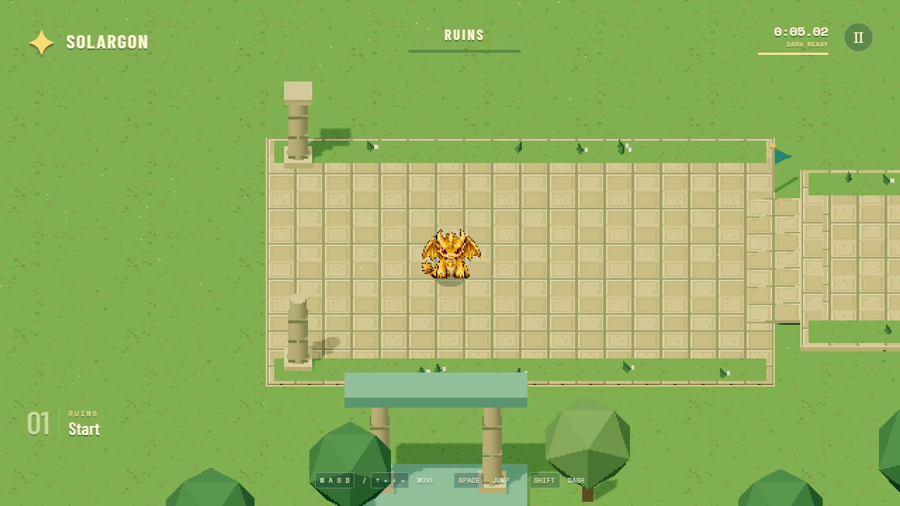
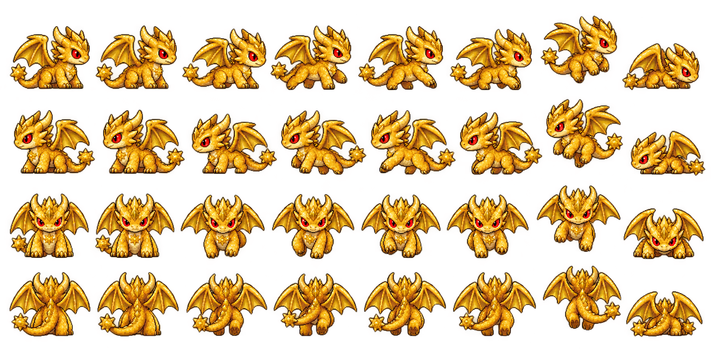
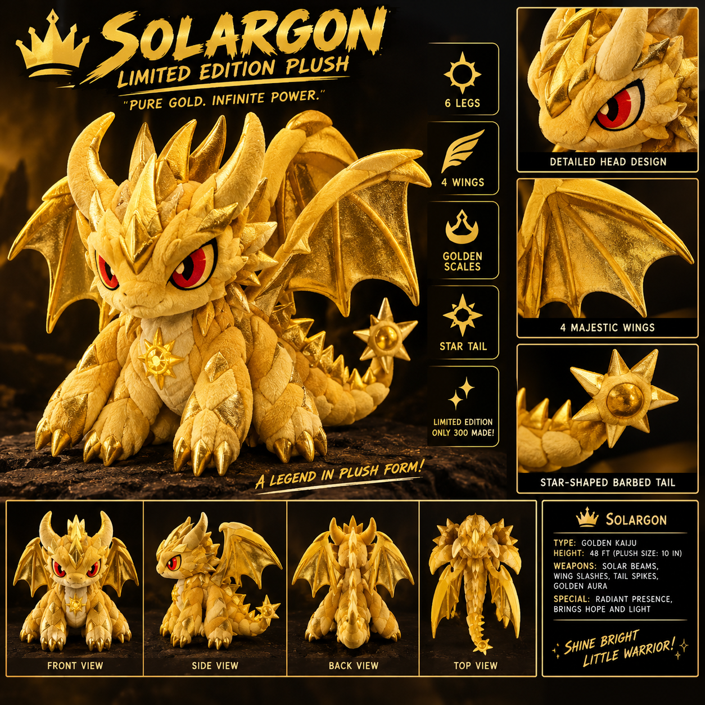
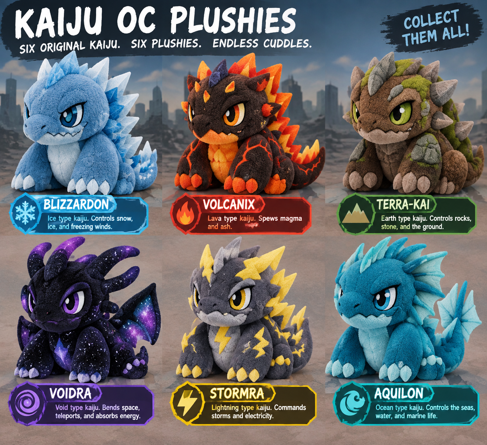
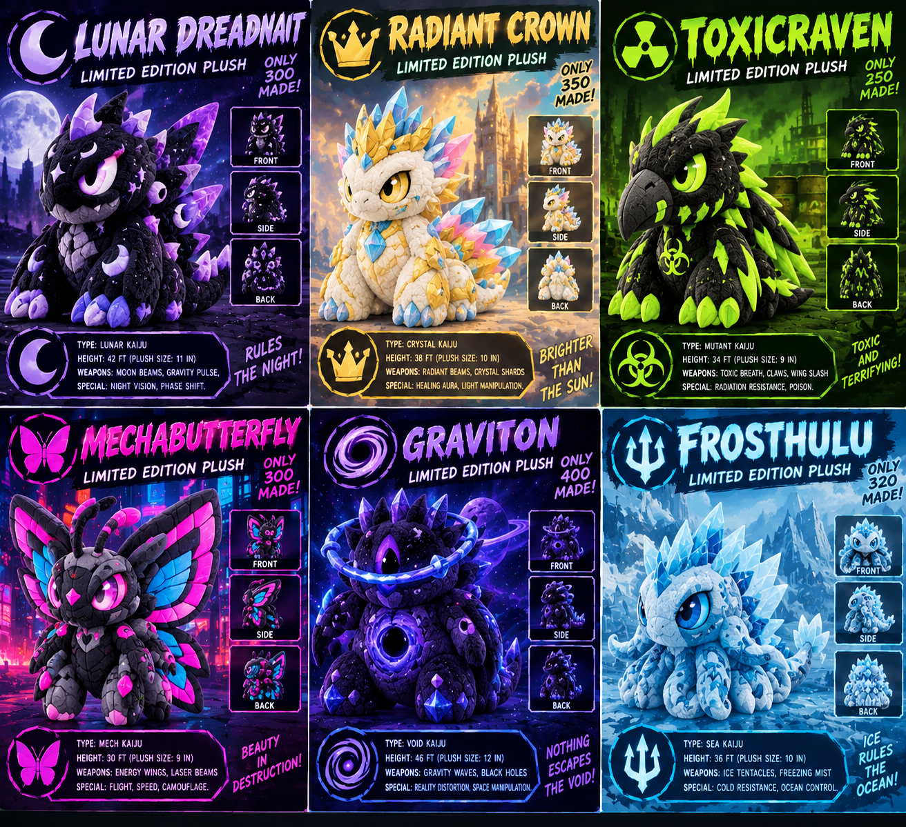

# Kaiju platformer art direction

Use this document when creating or integrating Voidra, Graviton, Toxicraven, or Blizzardon. It records the working direction established by Solargon's first course. The current sprite artwork is still a draft pending visual review; its clipping and anatomy errors are not style requirements.

## Reference priority

1. The team's latest explicit feedback.
2. Patrick's original character designs below: preserve identity and anatomy.
3. The game's current scene and Solargon gameplay artwork: match presentation and sprite treatment.
4. The production rules and prompt template in this document.

The posters are concept references, not animation sheets or textures to paste into the game. Their advertising text, frames, city backdrops, plush photography, and unrelated characters do not belong in gameplay assets. Do not replace a named character with another similarly colored kaiju from a group poster.

## The game style

**Ground-based 3D ruins with transparent, animated pixel-art characters.** The latest playtest feedback rejects the floating-island world. Use continuous grass terrain, low stone terraces, broad ramped paths, and safe ground beneath every route connection. Jumps and the moving platform are optional in this introductory course. Do not restore sky islands, void gaps, or precision-balancing paths.

The subsequent level-design pass adds raised shuttle docks, a longer lower-garden route, a walled gallery and final hurdles. Keep the safe walking route, but allow optional elevated connections with grass beneath: do not place a walkable bridge directly under a moving-platform shortcut. This is an intentional route choice, not a return to floating islands. See LEVEL_DESIGN.md for the current layout.

Use an elevated orthographic camera aligned to the movement axes, substantial readable silhouettes, warm stone, restrained foliage and turquoise distance fog. Characters should retain the rounded, compact proportions of the source designs, translated into pixel clusters rather than photographic plush textures.

The course screenshot establishes camera composition, character-to-platform scale, texture density and lighting. The Solargon atlas establishes the gold/brown outline treatment and broad sprite proportions. Compare new art in the live scene, not just against an enlarged sprite.

### Rendering constants

| Item | Current implementation |
| --- | --- |
| World | Three.js 3D geometry, Rapier collision |
| Internal resolution | 640 × 360, nearest-neighbor display scaling |
| Camera | Orthographic, 18 world units vertically, 16:9; offset (0, 16, 20) |
| Camera behavior | Fixed orientation aligned with world X/Z movement; responsive tracking without velocity look-ahead; screen-plane pixel snapping |
| Sprite behavior | Camera-facing transparent sprite, per-frame rectangles and ground anchors; render-only pixel snapping |
| Solargon scale | Manifest size 2.4; visible size also depends on frame padding and aspect ratio |
| Collision body | Capsule radius 0.34, half-height 0.4; feet 0.74 units below body center |
| Shadow | Small contact shadow under the character; softens with jump height |
| Interface | Sharp display-resolution text; plain labels and useful instructions |

Keep simulation positions continuous. Never change collision size to fit a wing or a tail. Align the planted feet to the shared ground point; the character's head and wings can extend beyond the capsule.

### Environment palette

These are source colors, before lighting and tone mapping. Match the rendered scene rather than sampling an already-lit screenshot and applying lighting twice.

| Role | Colors |
| --- | --- |
| Sky / distance fog | `#94DED0` |
| Stone and trim | `#D5C89F`, `#E6D5A2`, `#9B9F78` |
| Floor tiles | `#C5B78B`, `#D5C699`, `#EEE0B0` |
| Grass / foliage | `#6FA65B`, `#8DBA64`, `#548759` |
| Navigation flags | `#4DA9AA` |
| Sun gate / gold | `#F8CB63` |
| UI background / text | `#123F43`, `#FFF6D4` |

Use repeating masonry and tile structure, continuous grass, trees, simple flowers and occasional vines. All terraces sit within visible terrain. Connect the main route with wide, walkable ramps; stepping off lands on safe grass. Avoid floating scenery, voids, random surface noise, raw untextured blocks as final terrain, glossy photoreal materials, heavy bloom, excessive particles, or inconsistent pixel density. Keep walking and landing surfaces clearly visible.

## Character identities

The descriptions below are observed from the supplied sheets. Effect suggestions translate the requested ability into this game's style; they do not add new character powers.

| Character | Preserve from the source | Palette and silhouette separation | Later ability treatment |
| --- | --- | --- | --- |
| **Solargon** | Golden layered scales, crown-like horns, red eyes, cream belly, six legs, four wings and sun/star-tipped tail | Warm gold, ochre shadows and brown outline; broad winged silhouette | Solar beam: a short, readable gold/cream beam with a few square sparks |
| **Voidra** | Near-black body, purple swept horns, violet eyes, galaxy-pattern wing membranes and belly, pale lavender claws | Deep indigo/violet with sparse star clusters; expressive horns and wing shape | Teleport: brief violet departure/arrival marks, keeping the landing point readable |
| **Graviton** | Dark purple body, angular head/back spikes, central dark chest orb, luminous blue-violet orbital ring around head/shoulders | More geometric and ring-dominated than Voidra; electric violet highlights against dark purple | Gravity manipulation: a compact orbit/ripple effect around affected objects |
| **Toxicraven** | Black feather/scale body, distinct hooked raven beak, lime eyes, green feather/spine accents, lime claws, biohazard chest mark | Sharp beak and feather silhouette; charcoal and acid green; do not turn it into a generic green dragon | Corrosive projectile: compact lime glob with a short, sparse trail |
| **Blizzardon** | Rounded pale-blue body, white belly/claws, blue eyes, icy pale dorsal/head spikes and thick spiked tail | Cool blue/white, solid grounded silhouette; retain contrast against turquoise fog | Freeze: a small pale-blue burst and visible frost on the target |

Blizzardon is the provisional fifth character from the brief. Use the **Blizzardon** panel in the original roster, not FrostbiteZilla, Frosthulu, or another ice-themed character. Use **Voidra** from that same roster, not Lunar Dreadnaught. Graviton and Voidra must remain visibly different even though their themes overlap.

### Source sheets

Solargon: main design and front/side/back details.

Voidra: bottom-left panel. Blizzardon: top-left panel. Other characters on this sheet are outside the current roster.

Graviton: bottom-center panel. Toxicraven: top-right panel. Other panels are not substitutes for these characters.

## Sprite production requirements

- Use transparent PNG initially; WebP with alpha is supported by the runtime. No background, baked ground shadow, text, border, checkerboard, or promotional graphics.
- Draw crisp pixel clusters with a limited character-specific palette and a dark colored outline. Simplify tiny scales and galaxy speckles so they survive the 640 × 360 render. No soft image upscaling or photographic fabric texture.
- Use consistent anatomy in every view and pose. Do not mirror asymmetric design details without checking the original reference. Keep the complete silhouette inside its frame.
- For new finished movement sheets, use **96 × 96 cells, 9 columns × 4 rows**: 864 × 384 pixels. Keep at least 12 pixels of transparent padding on every edge; planted feet share baseline y = 83. A working generated candidate may be larger, but must be inspected and supplied with correct frame rectangles before use.
- Direction rows are **right, left, front, back**. All directions use the same scale and a slightly elevated viewing angle consistent with the scene.
- Columns are **idle 1, idle 2, run 1, run 2, run 3, run 4, jump, fall, land**. Run frames need an actual limb cycle. Jump and fall require distinct poses. A single land pose is sufficient for this milestone.
- Keep foot anchors consistent across animations; don't align frames by the tallest horn or widest wing. Match visible character size against Solargon in the courtyard, accounting for transparent padding.
- Future attack, special, damage and defeat clips can extend the manifest later. Do not create those mechanics or pretend a static effect is a missing animation.

The current Solargon draft uses an irregular 8 × 4 sheet and shares jump/fall artwork. That is a documented draft limitation. For a new 9-column sheet, set `columns: 9`, set falling to frame 7 and landing to frame 8, and supply its own rectangles/anchors. Movement code does not need to change.

The current `scripts/audit-sprites.ps1` has row boundaries specifically for Solargon v2. Do not run it unchanged on a new character and assume the output is valid. Author or derive that character's frame metadata from its actual sheet, then inspect it visually.

## Generation workflow and reusable prompt

Use the built-in image generation tool for raster character creation and edits. Attach the appropriate original sheet as the identity reference and Solargon's gameplay atlas as the style reference. Name the relevant panel explicitly. Ask for actual alpha transparency. Preserve source images and discarded drafts separately from active game assets.

Generate a single neutral character preview first. Compare it against the correct source panel and Solargon in the scene; obtain the team's visual feedback before treating it as final. Then create the directional animation frames. If a full atlas produces clipped silhouettes or inconsistent anatomy, generate smaller directional strips or individual poses rather than accepting a broken grid.

### Neutral character prompt template

> Create a transparent pixel-art gameplay sprite of [CHARACTER]. Use [SPECIFIC SOURCE PANEL] only for character identity and Solargon's gameplay sprite for the shared game style. Preserve [OBSERVED FEATURES FROM THE TABLE]. Use [CHARACTER PALETTE], compact rounded proportions, crisp readable pixel clusters and a dark colored outline. Show the complete body in a slightly elevated three-quarter view suitable for the existing orthographic 3D ruins. Match Solargon's visible screen size and detail density. Leave generous transparent margins. No typography, background, poster framing, fabric texture, external shadow, bloom or unrelated characters. Do not change the character's anatomy to resemble Solargon.

### Animation prompt extension

> Keep the approved neutral design, scale, anatomy, palette and outline unchanged. Produce [DIRECTION / POSES] with clear limb movement and consistent feet anchors. Use exact equal-sized cells, full silhouettes and wide transparent gutters. Inspect every frame for wing/tail clipping, drifting proportions, stray pixels and false transparency. The target movement set is two idle frames, four running frames, jump, fall and land in right, left, front and back views.

An image-generation request is not evidence that the requested grid, anatomy or transparency was produced correctly. Verify the actual result. Keep the final prompt and input references alongside the asset, as done in `art/GENERATION.md`.

## Integration and review checklist

- Compare neutral previews side by side with the correct concept panel and Solargon; confirm eyes, major colors, horns, limbs, wing count and tail shape.
- Inspect alpha and every frame boundary at full size; reject clipped silhouettes, background residue, stray neighboring limbs and changing anatomy.
- Inspect the animation at its actual small rendered size. Verify a readable run cycle, unique jump/fall poses, and a stable feet baseline when changing direction.
- Place the character on the existing course without changing camera, lighting, level scale or movement tuning to hide asset problems.
- Check idle, all four running directions, a short jump, a held jump, landing, pillar occlusion, depth readability and the contact shadow.
- Ensure the new palette is legible against both stone and turquoise fog, and effects do not obscure the character or landing surface.
- Document any remaining missing frames plainly. Update this reference when the team approves a style change.

Player-facing text is limited to functional labels, controls, time/results and menu buttons. No prose hints, descriptions, taglines, decorative area names, slogans, inspirational lines, marketing text or development notes in the interface.
