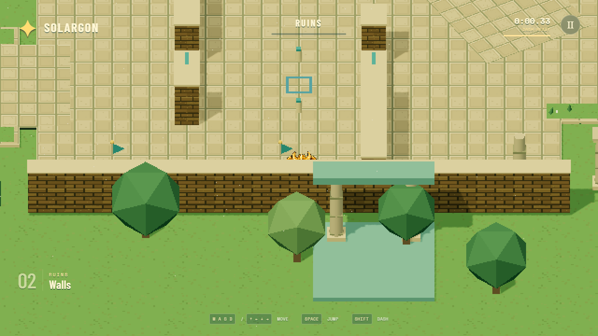

# QA results — October 27, 2026

Base: `c2a6265`. Current approved build uses 1920 × 1080 by default. The earlier 640 × 360 measurements below are retained as historical evidence.

## Recovery fix

Missing the shuttle lands on safe grass, but the lower path's 0.43-unit lip exceeded the controller's 0.28-unit automatic step height. Walking back onto the path was blocked.

Raised automatic step height to 0.5. The new browser regression walks from spawn to the dock, deliberately misses the shuttle, rejoins the low path without jumping, and completes the course. A physics regression also confirms the 0.8-unit hurdle still blocks walking and can be jumped.

## Verification

- Production build and strict TypeScript check passed.
- 25 physics/input tests passed.
- 12 browser checks passed: both keyboard routes, shortcut/shuttle route, missed-shuttle recovery, ordered finish, jumping/dashing, pause/restart/replay, focus handling, compact menus, synthetic controller input/disconnect/noise and anonymous public launch.
- Local safe route: 39.50 seconds; shortcut: 37.35 seconds. Scripted routes, not human playtimes.
- Courtyard benchmark: 144 FPS, 7 ms 95th-percentile frame interval; Edge headless, 1280 × 720 viewport, 640 × 360 rendering, RTX 5070 Ti Laptop GPU. Whole-course performance was not measured.
- Visible public-browser check covered the start, straight movement and pause. Inspected gallery, shuttle and recovery screenshots from scripted runs. No full manual playthrough claimed.

Physical DualSense USB/Bluetooth and Chromebook testing remain pending. Sprite anatomy/edge consistency remains a known draft-art issue.

[Recovery screenshot](art/playtest/shuttle-recovery.png). No UI copy or shared-document edits.

## Performance and visibility candidate

Reduced repeated static scenery to spatially grouped instances, preserving the moving shuttle and shadow/camera culling. Uploaded textures and compiled materials before Start. Added a faint silhouette only where nearer geometry obscures Solargon. Resolution, camera, sprite size and UI wording are unchanged.

Real-time keyboard walking route across all six sections, Edge headless on this laptop, 1280 × 720 viewport and 640 × 360 world. One baseline/candidate pair; not Chromebook results or proof that all stutters are eliminated.

| Measurement | Baseline | Candidate |
| --- | --- | --- |
| Average FPS | 143.6 | 143.9 |
| 95th-percentile frame interval | 7.1 ms | 7.0 ms |
| Longest frame | 48.6 ms | 27.9 ms |
| Frames over 33.4 ms | 3 | 0 |
| Average draw calls | 293 | 190 |

Build and 25 unit/physics tests pass. The standard browser suite passes 11 functional scenarios plus one visual capture; hosted smoke and hardware benchmark are opt-in. The full-course benchmark completed separately without falls or console errors. Gallery/shuttle screenshots and the before/after front-wall captures were inspected.

Raw measurements: [baseline](art/playtest/performance/baseline.json), [candidate](art/playtest/performance/candidate.json).

Repeat the hardware benchmark in PowerShell with `$env:COURSE_BENCHMARK='review'; npm run test:browser -- performance.spec.ts`. Production preview: `npm run preview -- --port 4173`.

## Approved 1080p default

1920 × 1080 is now the default in development and production. Camera/sprite pixel snapping follows that resolution. No query parameter is required; physics and artwork are unchanged.

Final default-build verification: 25 unit/physics tests and all 14 browser checks passed, including the real-time full-course benchmark and production smoke test. The full-course run averaged **144.0 FPS**, with **7.0 ms p95**, **7.6 ms longest frame** and no frames over 16.7 ms. [Default-build measurements](art/playtest/performance/default-1080p.json).

Full-course real-time run at a matching 1920 × 1080 browser viewport: **143.9 FPS average**, **7.0 ms p95**, **27.8 ms longest frame**, **zero frames over 33.4 ms**. Completed without falls or console errors. This meets 60 FPS on the tested RTX 5070 Ti laptop; Chromebook results remain untested.

[Raw 1080p measurements](art/playtest/performance/1080p.json) · [1080p visual capture](art/playtest/performance/occlusion-1080p.png).

Repeat with `$env:COURSE_BENCHMARK='review'; npm run test:browser -- performance.spec.ts`. Local production preview: `http://127.0.0.1:4173/`. Public build: `https://sstewart207.github.io/kaiju-platformer-prototype/`.
