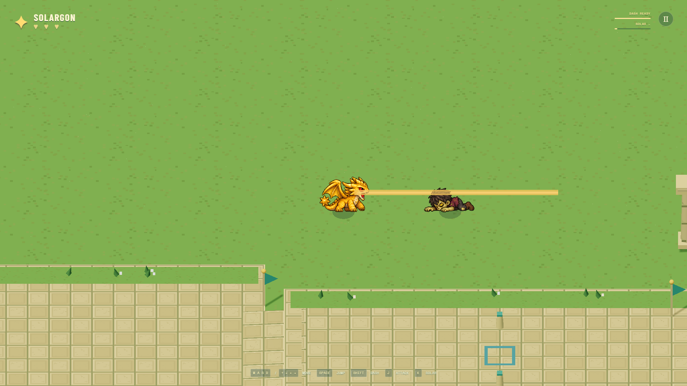

# Untitled kaiju platformer

A browser platformer featuring Patrick's kaiju characters, with 3D ruins and pixel-art sprites. Solargon is playable now. The game has no final name yet.

**[Play the public build](https://sstewart207.github.io/kaiju-platformer-prototype/)** in Chrome or Edge. No account or installation needed.

## Current state

**Public build:** a single-player ruins course with jumping, dashing, two checkpoints, optional moving-platform shortcuts, keyboard/DualSense controls and 1080p graphics. The tested walking route takes about 2:32.

Solargon can swipe and fire a solar beam. Three human-zombie encounters add patrols, melee attacks and fireballs; enemies can be defeated or avoided. Health and solar recharge appear in the HUD, with no area labels or visible timer. Combat sprites are replaceable drafts for team review.

Course tests run around 144 FPS on the development laptop. Shane reports DualSense working in his October 26 playtest. Chromebook performance and USB/Bluetooth-specific checks remain pending.

## Controls

| Action | Keyboard | DualSense |
| --- | --- | --- |
| Move | WASD / arrows | Left stick / D-pad |
| Jump | Space; hold for height | Cross; hold for height |
| Dash | Shift | Square / R1 |
| Attack | J | Circle |
| Solar beam | K | R2 |
| Pause | Escape | Options |
| Restart | R | Triangle |

## Next

Review combat feel and draft artwork. Character selection, more characters, co-op and human 1v1 matchmaking are planned.

[Test plan](TEST_PLAN.md) · [Backlog](TODO.md) · [Developer setup](DEVELOPMENT.md)
