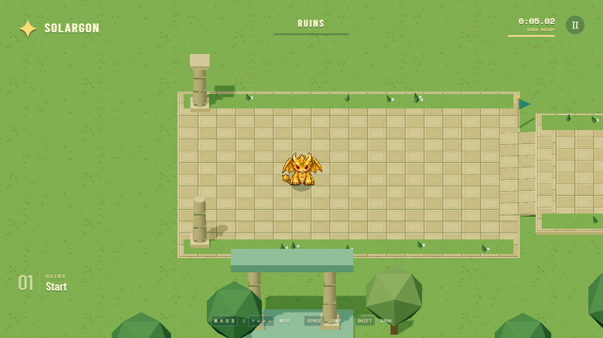

# Untitled kaiju platformer

**[Play the game](https://sstewart207.github.io/kaiju-platformer-prototype/)** in Chrome or Edge. No account or installation needed.

A browser platformer featuring Patrick's kaiju characters. Solargon is playable in the Ruins course. We haven't chosen the game's name yet.

## What's playable

- A longer Ruins course with slalom walls, jumpable hurdles, a moving platform, two checkpoints and a finish timer.
- Keyboard and DualSense controls, pause, restart and replay.
- 1080p graphics with pixel-art characters.
- One zombie kaiju encounter beside the starting route: dodge bites and fireballs, and dash through it twice to defeat it. Three hits return you to the last checkpoint.

The walking route has been checked at **2 minutes 32 seconds**, up from about 40 seconds. Faster jump/dash routes and the optional fight change your time.

The latest course test ran at 144 FPS on our development laptop. Chromebook performance and a real DualSense still need testing. Character artwork is a draft.

## Controls

| Action | Keyboard | DualSense |
| --- | --- | --- |
| Move | WASD / arrows | Left stick / D-pad |
| Jump | Space; hold to jump higher | Cross; hold to jump higher |
| Dash | Shift | Square / R1 |
| Pause | Escape | Options |
| Restart | R | Triangle |

## What's next

Improve movement, the course and the first enemy from playtest feedback. Character selection, more characters, more enemy types and co-op are planned; they aren't playable yet.

## Team notes

[Test plan and shared feedback](TEST_PLAN.md) · [Current status](SITREP.md) · [To-do list](TODO.md) · [Developer setup and technical details](DEVELOPMENT.md)
